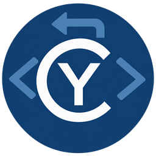

<p align="center"></p>

<h1 align="center">CyDecompilator</h1>

<p align="center">
Décompilateur multi-moteurs assisté par IA — Windows, Linux · x86, x64, ARM64 · .NET, Java, Android, Python, shaders
<br>


</p>

CyDecompilator ouvre presque n'importe quel binaire, montre son code reconstruit, et une IA aide à
le comprendre, à le renommer et à le réécrire en vrai code source. Il fonctionne aussi comme
serveur MCP, pour qu'une IA (Claude Code, Codex…) l'utilise directement.

## Lancer

- **Windows** : double-cliquer sur `CyDecompilator.exe`.
- **Linux** : `./CyDecompilator.sh` (nécessite un `runtime/python` créé sous Linux, voir
  [`app/README.md`](app/README.md)).

L'interface est en anglais par défaut. Onglet **Options** → *Language* : English, Français,
Deutsch, Español, Italiano, Português, Русский, 简体中文, 日本語, 한국어 (changement immédiat,
sans redémarrage). L'assistant IA répond dans la langue choisie.

## Ce qu'il sait ouvrir

| Fichier | Moteur | Résultat |
|---|---|---|
| `.exe`, `.dll`, ELF / `.so` Android (x86, x64, ARM64) | **CyDecompilator C** (intégré) | C structuré et recompilable, sans dépendance |
| `.exe`, `.dll`, `.so`, ELF, Mach-O, firmware brut | **Ghidra** | pseudo-code C (prioritaire s'il est installé) |
| `.exe`, `.dll`, ELF (x86, x64, ARM64) | **Désassembleur intégré** (Capstone) | assembleur annoté, appels, chaînes, imports |
| Assembly .NET (`.dll`, `.exe` managés) | **ILSpy** | C# |
| `.class`, `.jar` | **Vineflower** | Java |
| `.apk`, `.dex` (et `.jar`) | **JADX** | Java + AndroidManifest |
| `.pyc` | **Python** (xdis, uncompyle6, decompyle3) | source jusqu'à Python 3.8, bytecode pour toutes les versions |
| Shaders DXBC (`.cso`, `.fxc`), DXIL SM6, SPIR-V (`.spv`) | **Moteur shader de CyDecompilator** | HLSL (SM4/5 et SM6), GLSL |

Le format est reconnu à partir du contenu du fichier, pas de son extension.

## Le décompilateur C intégré

- x86 (cdecl, stdcall, thiscall, helpers MSVC), x64 (Win64, System V) et ARM64 (AAPCS64,
  Windows ARM64), fichiers PE et ELF.
- `if` / `else`, boucles, `switch` (tables de saut), flottants (SSE, x87, VFP), SIMD (SSE et
  NEON exprimés en intrinsèques SSE), prototypes des fonctions appelées déduits de leur code.
- Onglet *Program* : *Exported functions* / *This function and its callees* écrivent un fichier
  `.c` unique fait pour être recompilé (MSVC, clang) : variables globales initialisées depuis
  le binaire, constantes intégrées, imports reliés.
- Vérifié en recompilant le C produit et en comparant son exécution avec l'original (x86/x64 :
  120/120 ; ARM64 en émulation : 120/120) ; le C de vrais binaires Windows (cmd.exe, msvcrt,
  python311, vcruntime ARM64…) recompile sans erreur.

## Applications Windows (x86, x64, ARM64, DLL)

- **Symboles PDB** : le PDB d'un EXE/DLL est cherché dans les dossiers locaux puis téléchargé
  depuis le serveur de symboles Microsoft (vérifié GUID + âge, mis en cache dans
  `data/symbols`). Les vrais noms de fonctions et de classes apparaissent partout.
- **Détails de l'exécutable** (onglet *Program*) : protections (ASLR, DEP, CFG…), version,
  manifeste, outils de compilation (Rich header), exports, callbacks TLS, entropie des sections,
  overlay, signature, et ce qui a servi à le construire (Go, Rust, Delphi, Electron, Nuitka…).
- **Contenu embarqué** : bouton *Extract* pour les bundles **PyInstaller**, les applications
  **.NET single-file**, les fichiers **UPX** et les archives zip ajoutées. Chaque fichier extrait
  s'ouvre comme un nouveau projet.

## Premiers pas

1. Onglet **Engines** : installer les moteurs voulus (*Install*). Ils sont téléchargés depuis
   leurs sources officielles et vérifiés. Un Java 21+, un .NET ou un Ghidra déjà présents
   peuvent être utilisés via *Browse* / *Use*.
2. Onglet **Workspace** : *Open file...* (ou coller un chemin et Entrée).
3. Cliquer sur une fonction à gauche : son code s'affiche au centre. Double-clic sur un nom pour
   y aller, clic droit pour renommer ou chercher, boutons `<` `>` pour revenir.
4. Panneau **AI** à droite :
   - **Explain** : explication de la fonction ;
   - **Suggest names** (+ *Apply*) : noms parlants pour la fonction et ses variables ;
   - **Convert to source** : réécriture en vrai code (C, C++, C#, Java, Python, Rust, Go, HLSL,
     GLSL…), vérification par compilation et réparation automatique des erreurs ;
   - **Ask** : questions libres ; l'assistant parcourt lui-même le programme avant de répondre ;
   - **Name functions** : nomme en lot les fonctions générées (`FUN_*`, `sub_*`).

## Choisir l'IA

Onglet **AI assistant settings** :

- **Claude Code**, **Codex**, **Antigravity**, **OpenCode** : utilisent le compte déjà connecté
  dans ces programmes ; aucune clé à saisir. Ils sont lancés en lecture seule.
- **Anthropic**, **OpenAI**, **OpenRouter**, **serveur compatible OpenAI** (LM Studio, vLLM…),
  **Ollama** : clé d'API (enregistrée chiffrée avec DPAPI sous Windows) ou URL locale.

Le code envoyé à l'IA est celui de la fonction étudiée et ce que l'assistant demande via ses
outils. Avec un fournisseur en ligne, ce code quitte la machine.

## Utiliser depuis une IA (MCP)

```
claude mcp add cydecompilator -- "<dossier>\runtime\python\Scripts\python.exe" "<dossier>\app\tool.py" mcp
```

Toutes les fonctions de l'interface sont disponibles (`op_open_file`, `op_decompile`,
`op_c_module`, `op_rename`, `op_ai_convert`…). Voir [`app/README.md`](app/README.md).

## Mises à jour

Onglet *Engines*, section *Application updates* : *Check for updates* interroge les
[releases](https://github.com/MrMybal/CyDecompilator/releases) de ce dépôt, *Download and verify*
prépare la nouvelle version (empreinte SHA-256, identité, compilation), *Apply update* l'active en
gardant l'ancienne (*Restore previous version*). `data/` n'est jamais remplacé. Tant que le
dépôt est privé, il faut un jeton GitHub en lecture (champ *GitHub token* ou variable
d'environnement `GITHUB_TOKEN`).

## Où sont les choses

- `data/projects/` : un dossier par fichier ouvert (analyse, code en cache, renommages,
  commentaires, résultats IA).
- `data/settings/` : préférences, réglages IA, clés et jetons chiffrés.
- `data/logs/` : journal (aussi visible dans l'onglet *Application log*).
- `runtime/` : Python privé, moteurs téléchargés, mises à jour préparées.
- [`app/README.md`](app/README.md) : guide développeur (architecture, tests, releases).

## Limites connues

- Python ≥ 3.9 : pas de décompilateur libre complet ; bytecode + reconstruction par l'IA.
- DXIL : les bibliothèques de shaders (`lib_6_x`, raytracing) ne montrent que leur première fonction.
- Archives PyInstaller chiffrées (`--key`) et installeurs NSIS/Inno : détectés, pas extraits.
- Décompilateur C intégré : peu de reconstruction de types (structures vues comme
  `*(type *)(p + décalage)`) ; en ARM64 les paramètres entiers sont listés avant les flottants.
- Les gros binaires prennent du temps sous Ghidra ; le nombre de fonctions décompilées pendant
  l'analyse est réglable (onglet *Engines*).

## Licence

[GPL-3.0](LICENSE). Les moteurs téléchargés gardent leur propre licence (affichée dans l'onglet
*Engines* et dans *Options* → *Licenses*).

Ne décompiler que des logiciels que l'on a le droit d'analyser.
