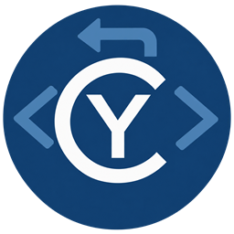
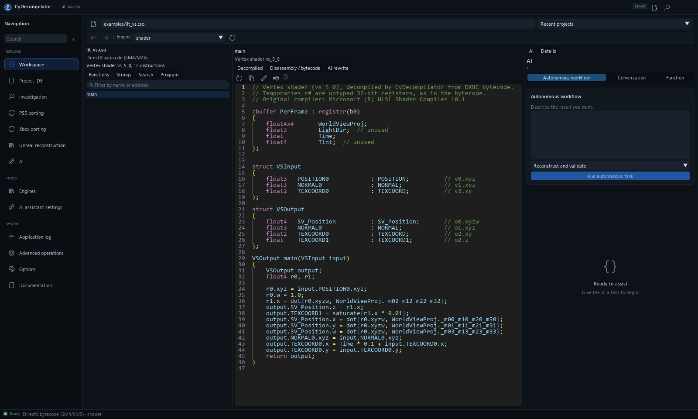
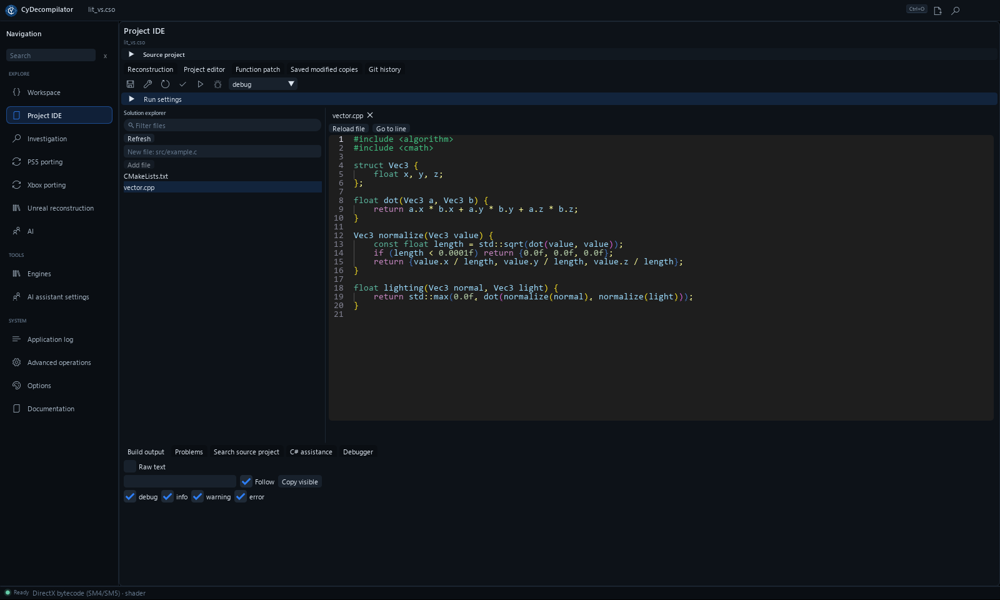
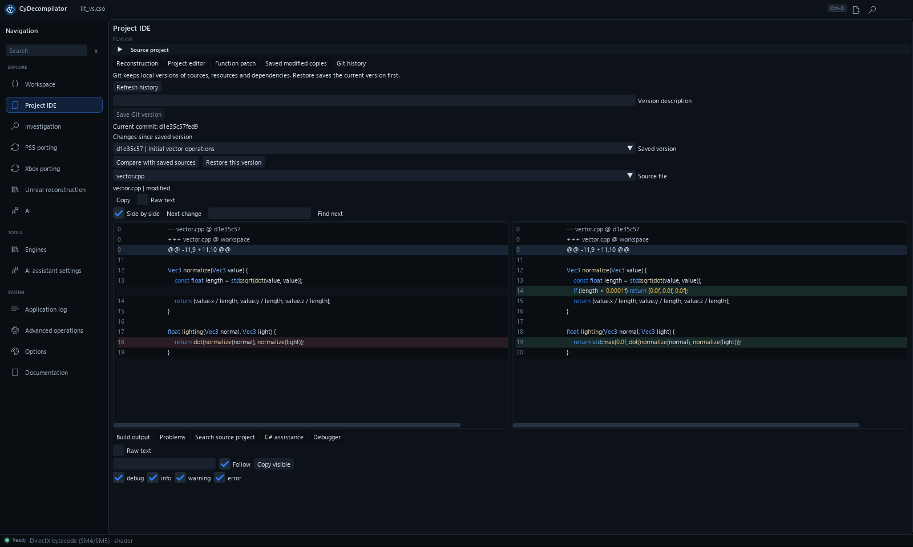
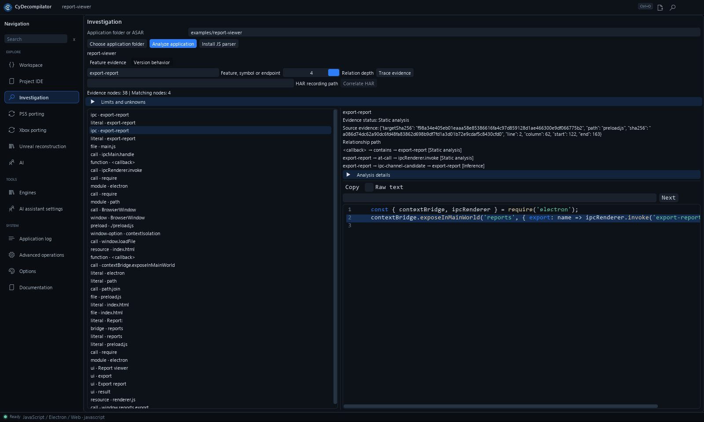

<table width="100%">
  <tr>
    <td width="300" align="left" valign="top">
      <a href="https://mrmybal.github.io/CyDecompilator/?lang=fr">Présentation</a><br>
      <a href="https://mrmybal.github.io/CyDecompilator/manual/Documentation.html#/fr/start">Documentation</a><br>
      <a href="https://github.com/MrMybal/CyDecompilator">Dépôt</a><br><br>
      <sub>README</sub><br>
      <a href="README.md">English</a> · <a href="README.fr.md">Français</a>
    </td>
    <td width="400" align="center" valign="middle">
      
    </td>
    <td width="300" align="right" valign="top">
      <p><sub>Licence de l’application</sub><br><a href="LICENSE"><strong>GPL-3.0-only</strong></a></p>
      <p><sub>Version</sub><br><a href="CHANGELOG.md"><strong>1.5.2</strong></a><br><strong>EN DÉVELOPPEMENT</strong></p>
      <p><a href="https://github.com/MrMybal/CyDecompilator/releases/download/v1.5.2/CyDecompilator-1.5.2-windows-x64-setup.exe"><strong>Télécharger l’installateur</strong></a><br><sub>Windows x64 · Python inclus</sub><br><a href="https://github.com/MrMybal/CyDecompilator/releases/download/v1.5.2/CyDecompilator-1.5.2-windows-x64-portable.zip">ZIP portable</a></p>
    </td>
  </tr>
</table>

<h1 align="center">CyDecompilator</h1>

Un espace de travail pour les développeurs et spécialistes de la rétro-ingénierie : comprendre une application compilée, modifier ses sources récupérées et tester les changements. Analyser les binaires natifs, .NET, Java, Android, le bytecode Python, JavaScript/Electron et les shaders, avec assistance IA et automatisation MCP optionnelles.

> **EN DÉVELOPPEMENT · 1.5.2**
>
> Windows x64 est pris en charge ; Linux x64 est expérimental. L’installateur et le ZIP portable incluent Python et les bibliothèques nécessaires. Consulter les [notes de version et limites documentées](CHANGELOG.md).

[](website/assets/workspace.png)

## À propos de CyDecompilator

Ouvrir un binaire, parcourir ses fonctions et suivre les références. Créer un projet source compatible dans **Project IDE**, modifier les fichiers puis utiliser la chaîne de compilation installée pour compiler, tester ou exécuter. Git conserve les versions et les comparaisons locales. Les rapports distinguent une compilation réussie d’un comportement validé sur des scénarios enregistrés ; ils ne garantissent pas une application identique.

[](website/assets/project.png)

## Fonctionnalités

### Ce qu'il sait ouvrir

| Fichier | Moteur | Résultat |
|---|---|---|
| `.exe`, `.dll`, ELF / `.so` Android (x86, x64, ARM64) | **CyDecompilator C** (intégré) | C structuré, recompilable lorsque pris en charge, sans moteur supplémentaire |
| `.exe`, `.dll`, `.so`, ELF, Mach-O, firmware brut | **Ghidra** | pseudo-code C (prioritaire s'il est installé) |
| `.exe`, `.dll`, ELF (x86, x64, ARM64) | **Désassembleur intégré** (Capstone) | assembleur annoté, appels, chaînes, imports |
| Assembly .NET (`.dll`, `.exe` managés) | **ILSpy** | C# |
| `.class`, `.jar` | **Vineflower** | Java |
| `.apk`, `.dex` (et `.jar`) | **JADX** | Java + AndroidManifest |
| `.pyc` | **Python** (xdis, uncompyle6, decompyle3) | source jusqu’à Python 3.8, bytecode des versions prises en charge par les outils installés |
| Shaders DXBC (`.cso`, `.fxc`), DXIL SM6, SPIR-V (`.spv`) | **Moteur shader de CyDecompilator** | HLSL (SM4/5 et SM6), GLSL |
| JavaScript/TypeScript/HTML, dossiers et ASAR | **Analyseur JavaScript** (optionnel) | Modules, emplacements sources, liens preload/IPC et source maps locales |

Le format est reconnu à partir du contenu du fichier, pas de son extension.

<details>
<summary>Analyse C native et exécutables Windows</summary>

### Le décompilateur C intégré

- x86 (cdecl, stdcall, thiscall, helpers MSVC), x64 (Win64, System V) et ARM64 (AAPCS64,
  Windows ARM64), fichiers PE et ELF.
- `if` / `else`, boucles, `switch` (tables de saut), flottants (SSE, x87, VFP), SIMD (SSE et
  NEON exprimés en intrinsèques SSE), prototypes des fonctions appelées déduits de leur code.
- Onglet *Program* : *Exported functions* / *This function and its callees* écrivent un fichier
  `.c` unique fait pour être recompilé (MSVC, clang) : variables globales initialisées depuis
  le binaire, constantes intégrées, imports reliés.

### Applications Windows (x86, x64, ARM64, DLL)

- **Symboles PDB** : le PDB d'un EXE/DLL est cherché dans les dossiers locaux puis téléchargé
  depuis le serveur de symboles Microsoft (vérifié GUID + âge, mis en cache dans
  `data/symbols`). Les vrais noms de fonctions et de classes apparaissent partout.
- **Détails de l'exécutable** (onglet *Program*) : protections (ASLR, DEP, CFG…), version,
  manifeste, outils de compilation (Rich header), exports, callbacks TLS, entropie des sections,
  overlay, signature, et ce qui a servi à le construire (Go, Rust, Delphi, Electron, Nuitka…).
- **Contenu embarqué** : bouton *Extract* pour les bundles **PyInstaller**, les applications
  **.NET single-file**, les fichiers **UPX** et les archives zip ajoutées. Chaque fichier extrait
  s'ouvre comme un nouveau projet.

</details>

### Premiers pas

1. Menu **Engines** : installer les moteurs voulus (*Install*). Ils sont téléchargés depuis
   leurs sources officielles et vérifiés. Un Java 21+, un .NET ou un Ghidra déjà présents
   peuvent être utilisés via *Browse* / *Use*.
2. Menu **Workspace** : *Open file...*, **Ctrl+O** ou coller un chemin et Entrée.
3. Cliquer sur une fonction à gauche : son code s'affiche au centre. Double-clic sur un nom pour
   y aller, clic droit pour renommer ou chercher, boutons `<` `>` pour revenir.
4. Panneau **AI** à droite ou menu **AI** : choisir **Autonomous workflow** pour une tâche
   complète, **Conversation** pour poser une question, ou **Function** pour les actions ciblées :
   - **Explain** : explication de la fonction ;
   - **Suggest names** (+ *Apply*) : noms parlants pour la fonction et ses variables ;
   - **Convert to source** : réécriture en vrai code (C, C++, C#, Java, Python, Rust, Go, HLSL,
     GLSL…), vérification par compilation et réparation automatique des erreurs ;
   - **Conversation → Send** : questions libres ; l'assistant parcourt lui-même le programme avant de répondre ;
   - **Name functions** : nomme en lot les fonctions générées (`FUN_*`, `sub_*`).

[](website/assets/history.png)

<details>
<summary>Édition de projet, Git, remplacement de fonctions et débogage .NET</summary>

### Éditer, reconstruire et tester un projet

L’onglet **Historique Git** du Project IDE conserve les versions locales du projet reconstruit.
Git doit être installé et accessible dans le PATH. Saisir une description, puis **Enregistrer une
version Git** sauvegarde les sources, ressources et dépendances locales. **Comparer avec les
sources enregistrées** affiche les modifications avant de choisir **Restaurer cette version**.
La restauration sauvegarde d’abord l’état actuel dans un commit récupérable, puis crée un nouveau
commit de restauration. Les fichiers ouverts sont rechargés ; enregistrer leurs modifications avant
la comparaison. Les copies .NET affichent le commit des sources lorsqu’une version correspondante
a été enregistrée avant leur création.

Le dépôt Git local est conservé dans les données d’analyse, séparément d’un éventuel dépôt déjà
présent dans les sources. Les dossiers de compilation, caches et métadonnées Git sont exclus ;
les fichiers binaires sont versionnés mais leurs différences ne sont pas affichées comme du texte.
Les versions sont limitées à 4 000 fichiers, 128 Mio au total et 32 Mio par fichier. La restauration
vérifie que les sources n’ont pas changé depuis l’aperçu et protège l’application originale.

Après avoir ouvert une application, l’onglet **Project IDE** propose **Create source project** :

- **.NET** : projet C# ILSpy, ressources récupérées et solution `.sln` ouvrable dans Visual Studio.
- **PE/ELF natif** : code C des fonctions exportées ou d’une fonction sélectionnée et de ses appels,
  cible EXE, DLL ou bibliothèque statique, projet `.vcxproj`, solution `.sln` et configuration CMake.
  Les entrées récupérées, imports, exports et ressources sont reconstruits ; les éléments inconnus
  restent des blocages explicites. ELF demande une chaîne de compilation et un environnement adaptés.
- **JavaScript, TypeScript, web et Electron** : sources et ressources éditables, configuration de
  compilation, sorties séparées et archive ASAR pour Electron. Les dépendances et le runtime doivent
  être disponibles ; les modules natifs exigent une version et une architecture compatibles.

**Project IDE → Reconstruction → Reconstruire et valider** enchaîne la création du projet,
la compilation, les tests optionnels et les comparaisons avec l’original. Activer les corrections IA
pour effectuer plusieurs tentatives, conservées dans Git, jusqu’à la limite choisie. Les scénarios
d’investigation peuvent être repris pour comparer interfaces, fichiers, sorties et réseau.
Le rapport distingue une compilation réussie d’un comportement validé sur les scénarios enregistrés.
Voir le [guide de reconstruction](app/Docs/Reconstruction.md) pour la configuration et les limites.

L’explorateur de solution permet d’ouvrir plusieurs fichiers dans des onglets éditables avec coloration
syntaxique. **Save all**, **Build**, **Rebuild**, **Test** et **Run** utilisent des tâches annulables.
Les erreurs de compilation figurent dans **Problems** ; cliquer dessus ouvre le fichier à la ligne indiquée.
**Open source project** rattache aussi un dossier C#, VC++ ou CMake existant. Une modification externe
du fichier empêche son écrasement ; les onglets modifiés sont protégés à la fermeture.
Les solutions `.sln`/`.slnx` contenant plusieurs projets sont prises en charge : **Build / startup project**
choisit le projet à compiler ou démarrer. **Entire solution** compile ou teste la solution entière ;
sélectionner un projet C# exécutable pour **Run**.
**Search source project** recherche dans les fichiers enregistrés, avec options de casse et de mot entier ;
un clic sur un résultat ouvre sa ligne. **Filter files** filtre l’explorateur et **Go to line** navigue dans
le fichier actif. **Reload file** recharge un fichier modifié sur disque, après confirmation si des
modifications non enregistrées doivent être abandonnées.

La compilation C# nécessite un **SDK .NET**, distinct du runtime installé pour ILSpy. Le C natif utilise
les outils C++ de Visual Studio sous Windows, ou CMake et un compilateur ailleurs. **Test** nécessite
des tests réellement définis ; **Run** d’une bibliothèque native nécessite un exécutable de test.
L’éditeur C# utilise **Roslyn**, fourni par un **SDK .NET 8 ou plus récent** avec ses composants
dotnet-format. **Compléter (Ctrl+Espace)** propose les membres accessibles du type et leurs signatures ;
cliquer sur une suggestion l’insère avec possibilité d’annuler. **Aller à la définition (F12)** retrouve
les déclarations, y compris dans un autre fichier ou un projet C# référencé. **Symboles C#** liste les
types et les membres du projet. **Assistance C#** affiche les diagnostics pendant l’édition et permet
de lancer l’analyse manuellement. Les modifications C# non enregistrées sont prises en compte sans
modifier les fichiers sur disque ; une suggestion périmée est rejetée si le code ou le curseur a changé.
**Aperçu du renommage sémantique** renomme le symbole choisi et ses références dans les fichiers/projets
concernés, sans toucher les homonymes. **Rechercher les références du symbole** affiche ses usages.
**Aperçu du formatage C#** propose le formatage Roslyn. Examiner les différences puis **Appliquer l’aperçu
aux fichiers ouverts** : les modifications restent dans l’éditeur, sont annulables et doivent être enregistrées.
Une modification des sources ou des buffers invalide l’aperçu avant toute application.

Les références restaurées des packages et les assemblies référencés sont utilisés lorsqu’ils sont
disponibles. Les étapes de compilation personnalisées, les propriétés conditionnelles, les analyseurs
et les sources générées peuvent demander une compilation pour un diagnostic complet ; le panneau
signale les références manquantes. Le helper d’édition est compilé localement sans téléchargement de
package. **Évaluer le projet avec MSBuild** exécute explicitement la résolution des références et prend en
compte les imports, propriétés conditionnelles et éléments Compile du projet. Les requêtes d’édition
suivantes lisent ce modèle sans relancer les targets ; une modification de la configuration ou des fichiers
du projet nécessite une nouvelle évaluation. Les projets multi-cibles utilisent leur première cible.
Les services sémantiques des autres langages restent à développer.

Pour modifier directement une fonction, choisir **Edit function / patch** dans Workspace, ou
**Function patch** dans Project IDE :

- **.NET** : **Load .NET methods**, sélectionner la méthode, puis **Edit declaring type** pour ouvrir
  son C# dans l’éditeur. **Build and verify method patch** recompile le projet et remplace uniquement
  le corps IL choisi dans l’assembly original. La nouvelle méthode peut être plus grande ; variables
  locales, branches, chaînes, appels internes et blocs try/catch sont pris en charge. Les lambdas, closures,
  fonctions locales, méthodes async et itérateurs sont pris en charge : leurs dépendances générées sont
  ajoutées sous des noms isolés, puis affichées dans l’aperçu. Choisir la méthode source plutôt qu’une
  fonction générée. Les corps des autres méthodes et les tokens existants sont vérifiés inchangés,
  même après plusieurs remplacements. Si plusieurs sorties existent, préciser l’assembly recompilé relatif au
  projet. Le SDK .NET et le helper dnlib 4.5.0, restauré automatiquement depuis NuGet officiel avec empreinte
  verrouillée, sont utilisés. **Importer les nouveaux membres .NET référencés** permet d’ajouter les helpers,
  types et champs compatibles utilisés par le remplacement. Les nouveaux types gardent leurs constructeurs,
  propriétés et événements. L’aperçu liste chaque ajout. Ajouter un champ d’instance à un type existant ou
  modifier son initialiseur reste réservé à une reconstruction complète, comme les changements de signature,
  images mixtes ou ReadyToRun. Les dépendances incompatibles ou dépassant les limites sont refusées.
  Une signature de nom fort doit être conservée par une reconstruction signée, ou supprimée explicitement
  via la case proposée ; sa suppression peut casser les dépendances. **Générer les symboles de la copie
  modifiée** produit un PDB portable correspondant aux méthodes importées.
- **PE natif x86/x64** : modifier son C, conserver sa signature et sa convention d’appel, puis
  **Compile and verify patch**. Les fonctions autonomes sans appels externes, réadressages ni métadonnées
  d’unwind sont acceptées si leur code tient dans l’emplacement d’origine. Clang (ou LLVM dans Visual Studio)
  est requis. Les cas incompatibles sont refusés.
  Le mode **Lier une fonction native plus grande avec appels et données d’exception** ajoute une section
  PE et redirige l’entrée d’origine : helpers, appels à des fonctions/imports existants, données, relocalisations
  ASLR et tables d’exception x64 sont liés. Les symboles connus sont résolus automatiquement ; le champ JSON
  permet d’associer un nom C à l’adresse d’une fonction ou d’un import existant. L’entrée doit fournir cinq
  octets complets, et le PE doit avoir un emplacement d’en-tête libre. CFG, nouveau TLS, symboles externes
  non résolus et relocalisations incompatibles nécessitent un lien complet.

**Write modified copy** crée une copie séparée avec un reçu SHA-256 ; l’original et les sorties existantes
ne peuvent pas être écrasés. Pour .NET, garder le nom du fichier original dans un nouveau dossier copie
également la configuration d’exécution et les dépendances produites par la compilation, si elles n’existent
pas déjà. Enregistrer puis préparer à nouveau le remplacement après un changement des sources.
**Analyze modified copy** permet de réouvrir le résultat. Une compilation réussie ne prouve pas
la compatibilité ABI ni l’équivalence du comportement ; une signature Authenticode existante est invalidée.

**Saved modified copies** retrouve les copies déjà créées, y compris après avoir relancé le logiciel.
**Run modified copy** lance la copie choisie avec ses arguments et une durée maximale réglable de 1 à
900 secondes. Les empreintes de l’exécutable et des dépendances copiées sont revérifiées avant le lancement.
Les sorties standard et d’erreur des compilations et des applications apparaissent pendant leur exécution.
**Cancel** et le délai maximal arrêtent également les processus enfants. Une DLL doit passer par un programme
de test ; elle n’est pas chargée dans le décompilateur. Un statut réussi indique un code de sortie nul,
sans garantir que le comportement est correct. La console capture la sortie ; elle ne fournit pas encore
de saisie interactive au programme. Le runtime .NET correspondant à l’application doit être installé.

Le panneau **Débogueur** permet maintenant de déboguer le projet .NET recompilé. Installer **NetCoreDbg**
depuis ce panneau ou l’onglet des moteurs, sélectionner le projet C# de démarrage, puis **Déboguer (F5)**.
Les sources sont enregistrées et recompilées en Debug avec leurs symboles PDB avant le lancement.
**F9** pose ou retire un point d’arrêt à la ligne du curseur dans un fichier enregistré ; les points d’arrêt
restent disponibles après un redémarrage. **F5** poursuit l’exécution, **F10** avance sans entrer dans
la fonction, **F11** entre dans la fonction, **Maj+F11** en sort et **Maj+F5** arrête le débogage.
Le panneau affiche la pile d’appels, les variables locales et les membres des objets. Cliquer sur un cadre
de pile ouvre sa ligne source ; la console de débogage affiche les sorties de l’application.

Les sources sont en lecture seule pendant la session : arrêter le débogage pour modifier et recompiler.
L’arrêt, l’annulation, le délai maximal et la fermeture du logiciel arrêtent aussi les processus enfants.
Un SDK .NET 8+ et le runtime de l’application sont nécessaires. Cette étape couvre les projets exécutables
.NET Core recompilés avec PDB portable ; les bibliothèques nécessitent un programme de test.
**Déboguer la copie modifiée** lance directement une copie .NET préparée avec ses symboles, sans la
recompiler. Les points d’arrêt, variables et machines d’état async utilisent les correspondances régénérées
des méthodes importées. Les méthodes non remplacées restent sans correspondance source régénérée.
Les sources et empreintes de la copie/dépendances doivent toujours correspondre au reçu ; conserver le
nom d’assembly original dans un nouveau dossier. Le débogage natif et .NET Framework restent à ajouter.
La console ne fournit pas de saisie interactive ni de modification des variables.

Les dépendances locales sont copiées dans le projet exporté avec des HintPath relatifs. Les fichiers XAML
sont éditables lorsqu’ils sont présents ; cela ne garantit pas la récupération de toutes les interfaces
ou protections d’applications tierces obfusquées.

</details>

### Examiner les preuves et comparer deux versions

L’onglet **Investigation** permet maintenant d’analyser un dossier JavaScript/Electron,
une archive ASAR ou des fichiers JS/TS/HTML. Installer l’analyseur JS depuis cet onglet
(Node.js requis), puis rechercher une fonctionnalité, un canal IPC ou une URL : les
résultats relient fichiers, fonctions, preload, ressources et appels avec leurs preuves.
Les source maps locales et captures HAR importées complètent ces rapprochements.

Pour le natif, sélectionner une fonction analysée avec Ghidra puis **Examiner la fonction
native sélectionnée** : types, sites d’appel, instructions et dépendances de valeurs.

Dans **Comportement des versions**, capturer deux exécutables avec les mêmes entrées et
fichiers initiaux pour comparer sorties, codes de retour et fichiers créés/modifiés/supprimés.
Ouvrir **Scénario réseau et graphique** pour enregistrer les connexions TCP et rejouer des
étapes sur les contrôles Windows ou un rendu Chromium/Electron (Node.js 22+). La comparaison
inclut les requêtes HTTP du rendu, la console, les états graphiques et les captures d’écran.
**Écrans capturés** affiche les versions côte à côte. Les résultats incomplets et limites
du périmètre sont affichés ; les fichiers extérieurs au dossier de travail restent hors observation.

Voir le [guide d’investigation](app/Docs/Investigation.md) pour les limites et le mode d’emploi.

[](website/assets/investigation.png)

<details>
<summary>Fournisseurs IA, parcours autonomes et MCP</summary>

### Choisir l'IA

Onglet **AI assistant settings** :

- **Claude Code**, **Codex**, **Antigravity**, **OpenCode** : utilisent le compte déjà connecté
  dans ces programmes ; aucune clé à saisir. Ils sont lancés en lecture seule.
- **Anthropic**, **OpenAI**, **OpenRouter**, **serveur compatible OpenAI** (LM Studio, vLLM…),
  **Ollama** : clé d'API (enregistrée chiffrée avec DPAPI sous Windows) ou URL locale.

Le code envoyé à l'IA est celui de la fonction étudiée et ce que l'assistant demande via ses
outils. Avec un fournisseur en ligne, ce code quitte la machine.

### Utiliser depuis une IA (MCP)

```
claude mcp add cydecompilator -- "<dossier>\runtime\python\Scripts\python.exe" "<dossier>\app\tool.py" mcp
```

Les opérations métier déclarées sont disponibles, dont l'analyse, la reconstruction,
la compilation, Git, la réinjection, le débogage .NET et les comparaisons réseau/graphiques.
Le [guide MCP et IA](app/Docs/AIIntegration.md) détaille la connexion et les parcours.
Un [skill dédié `cydecompilator`](app/skills/cydecompilator/SKILL.md) est livré :

```powershell
runtime/python/Scripts/python.exe app/scripts/install_skill.py
```

Il installe les instructions dans le dossier de skills de Codex ; la connexion MCP
se configure séparément.

Le panneau **AI** propose aussi **Lancer la tâche autonome** : choisir le parcours,
donner l'objectif et laisser l'assistant analyser, corriger, compiler et tester.
Les outils MCP `ai_agent` et `ai_agent_status` offrent le même mode, avec suivi,
reprise, sauvegardes Git et validation obligatoire avant de conclure.

</details>

<details>
<summary>Parcours Xbox/PS5 expérimentaux et connaissances Unreal</summary>

### Portage Xbox natif

La page **Portage Xbox** prépare les dossiers de jeu, XBE Xbox, XEX Xbox 360 et
images ISO/ZIP XDVDFS. Elle permet de créer un projet Xbox 360 CMake/ReXGlue
modifiable, le compiler ou rattacher un build natif existant puis le lancer depuis
CyDecompilator. Le SDK reste séparé et les originaux sont conservés.
La Xbox première génération reste limitée à l'inspection et à la préparation.
Le [guide intégré](app/Docs/XboxPorting.fr.md) documente aussi les méthodes utilisées,
les problèmes rencontrés et les limites ; une compilation ne prouve pas la compatibilité.

### Portage PS5 vers ordinateur

La page **Portage PS5** accepte un dossier d’application, ELF/SELF en clair, ZIP ou
un conteneur comme PKG/PFS. Elle prépare une copie de référence, convertit avec le
moteur externe facultatif **AnyPS5**, puis teste le résultat avec des scénarios
explicites. **UltraPack** fournit l’extraction des conteneurs. L’installation des
moteurs officiels est disponible dans la page ; leurs dépendances restent séparées.
Le parcours IA **Porter et tester** partage ces opérations MCP et exige des preuves
d’exécution avant de déclarer le travail terminé.

Nos moteurs natif/C analysent aussi les ELF sans sections et relient les diagnostics
et registres d’appels AnyPS5 aux instructions et fonctions d’origine. Un échec de
conversion peut déclencher automatiquement un dossier C/assembleur avec ses preuves
et ses inconnues, sans modifier l’application d’origine.

La compatibilité des jeux, API et graphismes ainsi que les performances dépendent
du moteur et du système hôte : une conversion réussie ne garantit ni jouabilité ni 60 FPS.
Voir [les prérequis et limites](app/Docs/PS5Porting.md).

### Règles de reconstruction Unreal

La page **Reconstruction Unreal** expose les 26 règles du prototype Halo Anniversary et les dix profils de campagne. Les mêmes données sont accessibles depuis le CLI, MCP et l’agent intégré. La conversion reste dans le module séparé. [Guide et limites](app/Docs/UnrealReconstruction.fr.md).

</details>

### Interface et aide intégrée

L’interface utilise **CyUI 1.2 modulaire** : vues de code et de différences communes,
journaux et diagnostics filtrables, rapports IA en Markdown, palette Ctrl+Maj+P et
captures avec zoom. [Intégration et limites](app/Docs/CyUIMigration.md).
Navigation permanente à gauche, barres d’outils avec infobulles,
explorateur et code redimensionnables, état des tâches en bas. **Options** propose cinq thèmes
(gris moyen, gris clair, nuit ambrée, violet, bleu nuit), une densité compacte ou confortable
et la taille du texte. Les anciennes préférences de thème sont reprises automatiquement.
Sur une petite fenêtre, l’IA reste accessible depuis son entrée dédiée du menu et
les détails de la fonction depuis un onglet près du code.

**[Documentation](https://mrmybal.github.io/CyDecompilator/manual/Documentation.html#/fr/start)** — ouvrez en
ligne le même lecteur CyDoc, avec navigation, recherche, images, schémas et choix de langue.

Ouvrez **Documentation** dans la barre latérale, ou appuyez sur **F1** pour l’aide
de la page courante. Le lecteur **CyDoc** fourni s’ouvre dans le navigateur par URL
locale `file://`, sans serveur ni connexion. Il comprend 22 chapitres en anglais (par
défaut) et en français, la recherche, les liens de sections, des captures agrandissables
dans la fenêtre et sept schémas SVG, ainsi que les références publiques des opérations
et des liens d’aide. Il couvre analyse, projets,
compilation, Git, remplacement de fonction, débogage, investigation, IA/MCP,
consoles, réglages, stockage et dépannage. Le point d’entrée hors ligne est `app/Documentation/Documentation.html`.
Les sources et instructions de génération sont dans [.CyDocBuild](app/.CyDocBuild/README.md).

---

## Installation

**Windows 10/11 x64 :** choisissez un paquet complet. Aucun ne nécessite un Python déjà installé.
Linux x64 reste expérimental et demande son propre runtime créé sous Linux ; les paquets Windows n’y fonctionnent pas.

### Installateur

1. [Télécharger l’installateur Windows](https://github.com/MrMybal/CyDecompilator/releases/download/v1.5.2/CyDecompilator-1.5.2-windows-x64-setup.exe).
2. Lancer la configuration, choisir anglais ou français et le dossier d’installation. Le mode par défaut pour le compte courant ne demande pas de droits administrateur ; le raccourci sur le bureau est optionnel.
3. Démarrer **CyDecompilator** depuis le menu Démarrer. La désinstallation conserve les projets, réglages et moteurs créés après installation.

### Portable

1. [Télécharger le ZIP portable complet](https://github.com/MrMybal/CyDecompilator/releases/download/v1.5.2/CyDecompilator-1.5.2-windows-x64-portable.zip).
2. Extraire toute l’archive dans un dossier accessible en écriture. Conserver `app/` et `runtime/` à côté de `CyDecompilator.exe`.
3. Lancer `CyDecompilator.exe`. Les données restent dans `data/` au sein du dossier portable. Fermer le logiciel avant de déplacer ce dossier.

Les moteurs et outils de compilation C/C++/.NET/Java/Node optionnels s’installent séparément depuis **Moteurs** ou leurs installateurs officiels. Consulter les [notes et fichiers SHA-256](https://github.com/MrMybal/CyDecompilator/releases/tag/v1.5.2).

### Mises à jour et fichiers locaux

La petite archive `CyDecompilator-1.5.2.zip` est une **mise à jour applicative seule**, pour un runtime compatible existant. Dans **Moteurs → Mises à jour de l’application**, télécharger, vérifier, appliquer ou restaurer une version. L’outil choisit cette archive indépendamment de l’ordre des paquets complets et préserve `data/` ainsi que le runtime existant.

`data/projects/` contient analyses, commentaires et code en cache ; `data/settings/`, les préférences et identifiants ; `data/logs/`, les journaux. `runtime/` conserve Python, moteurs téléchargés et mises à jour préparées.

## Sources, compilation et bibliothèques nécessaires

<details>
<summary>Préparer et lancer depuis les sources</summary>

Utiliser Python 3.11, Git et [les dépendances du runtime](app/requirements.txt). Le SDK CyToolsCore
épinglé est récupéré par Git ; l’accès aux sources peut nécessiter votre compte GitHub. Créer
l’environnement virtuel à son emplacement définitif : un venv Python n’est pas déplaçable.

```powershell
git clone https://github.com/MrMybal/CyDecompilator.git
cd CyDecompilator
py -3.11 -m venv runtime\python
runtime\python\Scripts\python.exe -m pip install -r app\requirements.txt
runtime\python\Scripts\python.exe app\desktop.py
```

Pour recompiler le lanceur Windows, installer les outils C++ de Visual Studio puis exécuter :

```powershell
powershell -ExecutionPolicy Bypass -File app\build_launcher.ps1
```

Sous Linux expérimental, créer `runtime/python` avec Python 3.11, installer `app/requirements.txt`
avec le `bin/python` de cet environnement puis lancer `./CyDecompilator.sh`. Un runtime Windows
ne peut pas être réutilisé. Les services et compilations C# demandent un SDK .NET 8+ ; les projets
natifs nécessitent un compilateur adapté et CMake. Les scénarios navigateur demandent Node.js 22+.

La régénération documentaire demande aussi Node.js 22+, uniquement pendant la compilation :

```powershell
runtime/python/Scripts/python.exe app/scripts/build_documentation.py --setup
runtime/python/Scripts/python.exe app/scripts/build_documentation.py --check
runtime/python/Scripts/python.exe app/scripts/build_website.py
runtime/python/Scripts/python.exe app/scripts/build_website.py --check
```

La lecture du manuel exporté ne demande aucun de ces outils. Voir le [guide développeur](app/README.md),
[les outils documentaires](app/.CyDocBuild/README.md) et [la couverture des fonctions](app/Docs/CapabilityCoverage.md).

</details>

---

## Licence

**CyDecompilator utilise [GPL-3.0-only](LICENSE).** Analyser uniquement les logiciels que vous avez le droit d’examiner. Les dépendances conservent leurs conditions ; une dépendance MIT ne change pas la licence de l’application.

### Runtime et composants inclus

| Bibliothèque · sources | Licence · texte | Utilisation / périmètre |
| --- | --- | --- |
| [CyToolsCore 0.10.1](https://github.com/MrMybal/CyToolsCore) | [MIT](app/packaging/vendor/CyToolsCore-LICENSE.txt) | SDK requis pour le runtime, la CLI et MCP, révision Git épinglée ; accès aux sources éventuellement soumis à autorisation. |
| [CyUI 1.2.0](https://github.com/MrMybal/CyUI) | [MIT](app/vendor/CYUI_LICENSE.txt) | Modules Python sélectionnés et inclus ; dépôt privé, [provenance épinglée](app/vendor/cyui-source.json). |
| [Dear ImGui / imgui-bundle 1.92.900](https://github.com/pthom/imgui_bundle) | [MIT + notices des composants](https://github.com/pthom/imgui_bundle/blob/main/LICENSE) | Runtime de l’interface et de l’éditeur natifs ; conserver les notices des composants et polices, dont Inconsolata SIL OFL 1.1. |
| [Capstone 5.0.9](https://github.com/capstone-engine/capstone) | [BSD-3-Clause](https://www.capstone-engine.org/License.html) | Désassemblage et représentation intermédiaire pour le moteur C à l’exécution. |
| [pefile 2024.8.26](https://github.com/erocarrera/pefile) | [MIT](https://github.com/erocarrera/pefile/blob/master/LICENSE) | Analyse PE à l’exécution. |
| [pyelftools 0.33](https://github.com/eliben/pyelftools) | [Domaine public / Unlicense + notice du composant](https://github.com/eliben/pyelftools/blob/main/LICENSE) | Analyse ELF à l’exécution ; conserver la notice de construct incluse. |
| [NumPy](https://github.com/numpy/numpy) | [BSD-3-Clause + notices des composants](https://github.com/numpy/numpy/blob/main/LICENSE.txt) | Runtime numérique requis ; les roues incluent des composants sous d’autres licences. |
| [HTTPX 0.28.1](https://github.com/encode/httpx) | [BSD-3-Clause](https://github.com/encode/httpx/blob/0.28.1/LICENSE.md) | Clients HTTP à l’exécution. |
| [pywin32 312](https://github.com/mhammond/pywin32) | [PSF + notices des composants](https://github.com/mhammond/pywin32#license) | Intégration à l’exécution, uniquement sous Windows. |
| [CPython](https://github.com/python/cpython) | [PSF + notices des composants](https://github.com/python/cpython/blob/3.11/LICENSE) | Runtime autonome inclus dans les paquets Windows complets. |
| [CyDoc 0.1.0](https://github.com/MrMybal/CyDoc) | [MIT](app/Documentation/DocData/CyDoc-LICENSE.txt) | Lecteur et module image inclus ; sources privées, [provenance épinglée](app/.CyDocBuild/vendor/cydoc-source.json). Aucune dépendance mesh/Three.js. |
| [cyai_connectors](app/cydec/ai/vendor/cyai_connectors) | [Registre des composants](app/licenses.json) | Adaptateur CLI inclus, issu de CyTools_AIChat ; aucune licence distincte déclarée. Les programmes fournisseurs gardent leurs conditions. |

<details>
<summary>Moteurs optionnels, helpers et dépendances de compilation</summary>

| Bibliothèque · sources | Licence · texte | Utilisation / périmètre |
| --- | --- | --- |
| [Ghidra](https://github.com/NationalSecurityAgency/ghidra) | [Apache-2.0](https://github.com/NationalSecurityAgency/ghidra/blob/master/LICENSE) | Analyseur natif optionnel installé séparément. |
| [Eclipse Temurin / OpenJDK](https://adoptium.net/) | [GPL-2.0 + Classpath Exception](https://adoptium.net/docs/faq/) | Runtime Java séparé pour Ghidra et les moteurs Java. |
| [ILSpy](https://github.com/icsharpcode/ILSpy) | [MIT](https://github.com/icsharpcode/ILSpy/blob/master/LICENSE) | Décompilateur .NET optionnel installé séparément. |
| [Vineflower](https://github.com/Vineflower/vineflower) / [JADX](https://github.com/skylot/jadx) | [Apache-2.0](https://github.com/Vineflower/vineflower/blob/master/LICENSE.md) / [Apache-2.0](https://github.com/skylot/jadx/blob/master/LICENSE) | Analyseurs Java/Android optionnels installés séparément. |
| [xdis](https://github.com/rocky/python-xdis), [uncompyle6](https://github.com/rocky/python-uncompyle6), [decompyle3](https://github.com/rocky/python-decompile3) | [GPL-2.0-or-later](https://github.com/rocky/python-xdis/blob/master/COPYING) / [GPL-3.0](https://github.com/rocky/python-uncompyle6/blob/master/COPYING) / [GPL-3.0](https://github.com/rocky/python-decompile3/blob/master/COPYING) | Outils de bytecode optionnels isolés. |
| [dnlib 4.5.0](https://github.com/0xd4d/dnlib) | [MIT](https://github.com/0xd4d/dnlib/blob/master/LICENSE.txt) | Helper de remplacement .NET restauré à la demande ; [package verrouillé](app/managed/packages.lock.json). |
| [Roslyn](https://github.com/dotnet/roslyn) / [.NET](https://github.com/dotnet/runtime) | [MIT](https://github.com/dotnet/roslyn/blob/main/License.txt) / [MIT](https://github.com/dotnet/runtime/blob/main/LICENSE.TXT) | Services C# du SDK installé ; chaînes de compilation et runtimes cibles séparés. |
| [NetCoreDbg](https://github.com/Samsung/netcoredbg) | [MIT](https://github.com/Samsung/netcoredbg/blob/master/LICENSE) | Débogueur .NET optionnel installé séparément. |
| [TypeScript](https://github.com/microsoft/TypeScript) / [Electron](https://github.com/electron/electron) | [Apache-2.0](https://github.com/microsoft/TypeScript/blob/main/LICENSE.txt) / [MIT + notices](https://github.com/electron/electron/blob/main/LICENSE) | Analyse JS et exécution Electron reconstruit optionnelles. |
| [ReXGlue](https://github.com/rexglue/rexglue-sdk) | [BSD-3-Clause + notices](app/xbox_support/third_party/rexglue/LICENSE) | SDK Xbox 360 séparé ; notices conservées dans les sources sélectionnées. |
| [SMAA](https://github.com/iryoku/smaa) | [MIT](app/xbox_support/third_party/smaa/LICENSE.txt) | Sources et tables de référence pour le plugin GPU natif optionnel. |
| [AnyPS5](https://github.com/boykopovar/AnyPS5) | [GPL-2.0-only + notices des dépendances](app/engine-patches/AnyPS5-LICENSE.txt) | Backend PS5 séparé et correctifs sources expérimentaux optionnels. |
| [PS5 UltraPack](https://github.com/knutwurst/ps5-ultrapack) | MIT (source); conditions supplémentaires des composants | Extracteur séparé optionnel ; conserver les notices du dépôt installé et les conditions des composants. |
| [marked](https://github.com/markedjs/marked), [PrismJS](https://github.com/PrismJS/prism), [esbuild](https://github.com/evanw/esbuild) | [MIT](https://github.com/markedjs/marked/blob/v17.0.6/LICENSE.md) / [MIT](https://github.com/PrismJS/prism/blob/v1.30.0/LICENSE) / [MIT](https://github.com/evanw/esbuild/blob/v0.25.12/LICENSE.md) | Compilation documentaire uniquement ; versions exactes dans le [verrou npm](app/.CyDocBuild/package-lock.json). |
| [pytest](https://github.com/pytest-dev/pytest), [PyYAML](https://github.com/yaml/pyyaml), [Unicorn](https://github.com/unicorn-engine/unicorn) | [MIT](https://github.com/pytest-dev/pytest/blob/main/LICENSE) / [MIT](https://github.com/yaml/pyyaml/blob/main/LICENSE) / [GPL-2.0 + notices](https://github.com/unicorn-engine/unicorn/blob/master/COPYING) | Dépendances de développement et de test de [requirements-dev.txt](app/requirements-dev.txt). |

</details>

Ce tableau indexe les principaux composants ; il ne remplace pas les notices transitives complètes. Conserver les licences des packages Python, composants natifs, polices et moteurs installés séparément. Les conditions figurent aussi dans **Options → Licences** et **Moteurs**.

## Références et liens

- [Documentation](https://mrmybal.github.io/CyDecompilator/manual/Documentation.html#/fr/start) · [Manuel anglais](https://mrmybal.github.io/CyDecompilator/manual/Documentation.html#/en/start).
- [Présentation](https://mrmybal.github.io/CyDecompilator/?lang=fr) · [Téléchargements](https://github.com/MrMybal/CyDecompilator/releases) · [Notes de version](CHANGELOG.md).
- [Dépôt des sources](https://github.com/MrMybal/CyDecompilator) · [Suivi des problèmes](https://github.com/MrMybal/CyDecompilator/issues).

<details>
<summary><strong>AI Usage</strong></summary>

- [Commencer ici : instructions du projet](app/AGENTS.md) — règles d’architecture et guides importants.
- [Compiler cette application](app/README.md) — préparation du runtime, commandes et distribution.
- [Intégration MCP et IA](app/Docs/AIIntegration.md) — connexions et parcours disponibles.
- [Skill CyDecompilator](app/skills/cydecompilator/SKILL.md) — investigation, reconstruction, remplacement et validation.
- [Contrats des opérations installées](app/Documentation/DocAI.md) — référence d’automatisation séparée.

</details>
