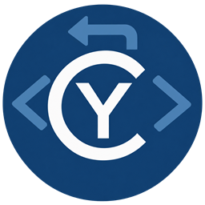
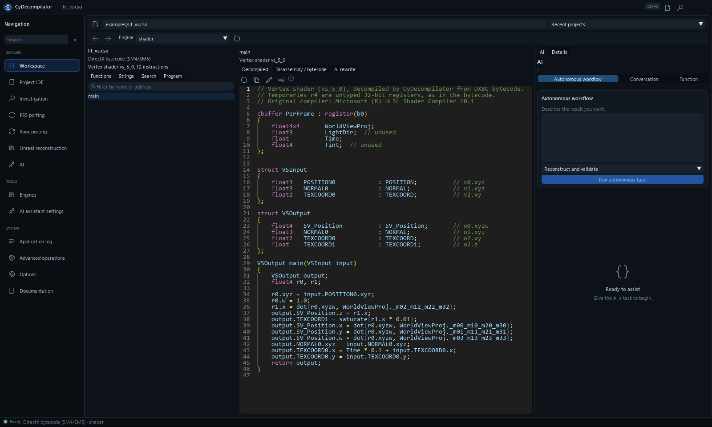
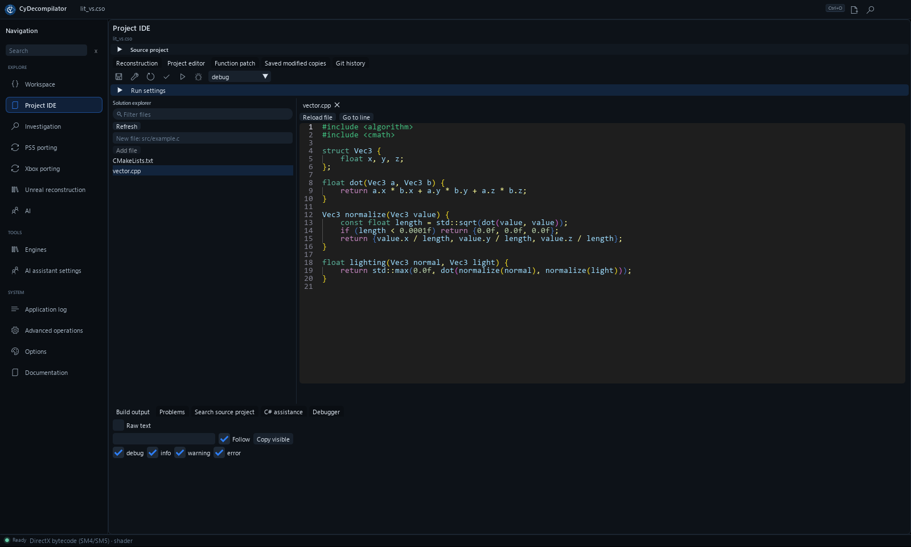
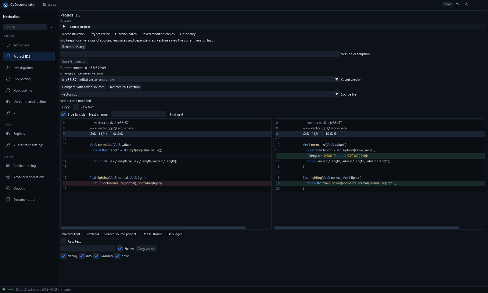
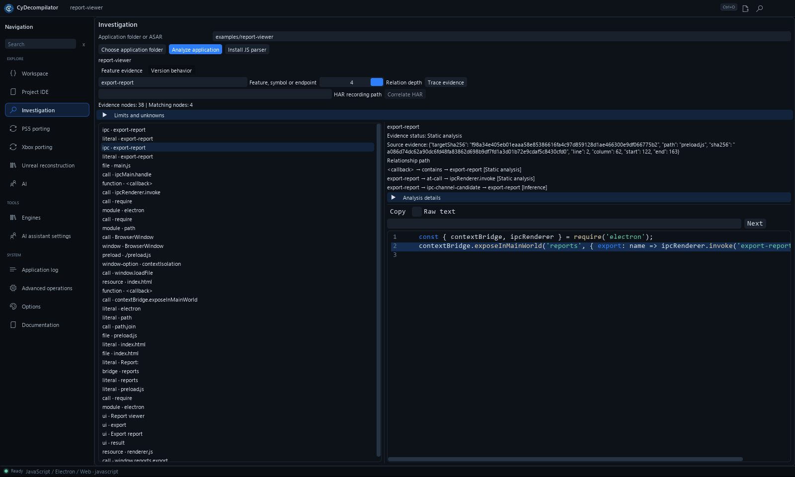

<table width="100%">
  <tr>
    <td width="300" align="left" valign="top">
      <a href="https://mrmybal.github.io/CyDecompilator/?lang=en">Website</a><br>
      <a href="https://mrmybal.github.io/CyDecompilator/manual/Documentation.html#/en/start">Documentation</a><br>
      <a href="https://github.com/MrMybal/CyDecompilator">Repository</a><br><br>
      <sub>README</sub><br>
      <a href="README.md">English</a> · <a href="README.fr.md">Français</a>
    </td>
    <td width="400" align="center" valign="middle">
      
    </td>
    <td width="300" align="right" valign="top">
      <p><sub>Application license</sub><br><a href="LICENSE"><strong>GPL-3.0-only</strong></a></p>
      <p><sub>Version</sub><br><a href="CHANGELOG.en.md"><strong>1.5.1</strong></a><br><strong>IN DEVELOPMENT</strong></p>
      <p><a href="https://github.com/MrMybal/CyDecompilator/releases/download/v1.5.1/CyDecompilator-1.5.1.zip"><strong>Download</strong></a><br><sub>Windows x64 · application update<br>Existing compatible runtime required</sub></p>
    </td>
  </tr>
</table>

<h1 align="center">CyDecompilator</h1>

A desktop workspace for reverse engineers and developers: understand compiled applications, edit recovered sources and test changes. Inspect native binaries, .NET, Java, Android, Python bytecode, JavaScript/Electron and shaders, with optional AI assistance and MCP automation.

> **IN DEVELOPMENT · 1.5.1**
>
> Windows x64 is supported; Linux x64 is experimental. The published ZIP updates an existing installation and requires its compatible Python runtime. Read the [version notes and documented limitations](CHANGELOG.en.md).

[](website/assets/workspace.png)

## About CyDecompilator

Open a binary, navigate its functions and follow references. Create a supported source project in **Project IDE**, edit its files, then use your installed toolchain to build, test or run it. Git keeps local snapshots and source comparisons. Reconstruction reports distinguish a successful build from behavior validated against recorded scenarios; they do not guarantee an identical application.

[](website/assets/project.png)

## Features

### Supported inputs

| File | Engine | Output |
|---|---|---|
| `.exe`, `.dll`, ELF / Android `.so` (x86, x64, ARM64) | **CyDecompilator C** (built in) | Structured C, recompilable where supported, without an additional engine |
| `.exe`, `.dll`, `.so`, ELF, Mach-O, raw firmware | **Ghidra** | C pseudocode; preferred when installed |
| `.exe`, `.dll`, ELF (x86, x64, ARM64) | **Built-in disassembler** (Capstone) | Annotated assembly, calls, strings and imports |
| .NET assemblies (managed `.dll`, `.exe`) | **ILSpy** | C# |
| `.class`, `.jar` | **Vineflower** | Java |
| `.apk`, `.dex` and `.jar` | **JADX** | Java + AndroidManifest |
| `.pyc` | **Python** (xdis, uncompyle6, decompyle3) | Source through Python 3.8; bytecode for versions supported by the installed tools |
| DXBC shaders (`.cso`, `.fxc`), DXIL SM6, SPIR-V (`.spv`) | **CyDecompilator shader engine** | HLSL (SM4/5 and SM6), GLSL |
| JavaScript/TypeScript/HTML, folders and ASAR | **JavaScript analyzer** (optional) | Modules, source locations, preload/IPC relationships and local source maps |

Formats are detected from file contents rather than extensions.

<details>
<summary>Native C analysis and Windows executables</summary>

### Built-in C decompiler

- x86 (cdecl, stdcall, thiscall, MSVC helpers), x64 (Win64, System V) and ARM64 (AAPCS64,
  Windows ARM64), with PE and ELF support.
- `if` / `else`, loops, `switch` jump tables, floating point (SSE, x87, VFP), SIMD (SSE and
  NEON expressed as SSE intrinsics), and called-function prototypes inferred from their code.
- In the *Program* tab, *Exported functions* / *This function and its callees* export a single
  `.c` file for recompilation with MSVC or clang: initialized globals recovered from the binary,
  embedded constants and linked imports.

### Windows applications (x86, x64, ARM64, DLL)

- **PDB symbols**: searches local folders, then the Microsoft symbol server. GUID and age are
  verified, and symbols are cached in `data/symbols`. Recovered function and class names are
  used throughout the application.
- **Executable details** (*Program* tab): protections (ASLR, DEP, CFG), version, manifest,
  build tools (Rich header), exports, TLS callbacks, section entropy, overlay, signature and
  indicators of the original toolchain (Go, Rust, Delphi, Electron, Nuitka and others).
- **Embedded content**: *Extract* handles **PyInstaller** bundles, **.NET single-file**
  applications, **UPX** files and appended ZIP archives. Each extracted file can open as a new project.

</details>

### Getting started

1. Open **Engines** and *Install* the engines you need. Downloads come from official sources
   and are verified. An existing Java 21+, .NET or Ghidra installation can be selected with *Browse* / *Use*.
2. Open **Workspace**, then *Open file...*, press **Ctrl+O**, or paste a path and press Enter.
3. Select a function on the left to display its code. Double-click a name to navigate to it,
   right-click for rename and search actions, and use the back/forward buttons to navigate history.
4. In the right-hand **AI** pane or dedicated **AI** page, select **Autonomous workflow** for
   a complete task, **Conversation** for questions, or **Function** for focused actions:
   - **Explain**: explains the selected function.
   - **Suggest names** (+ *Apply*): proposes meaningful names for the function and its variables.
   - **Convert to source**: rewrites code into C, C++, C#, Java, Python, Rust, Go, HLSL, GLSL
     and other supported targets, with compilation checks and automatic error repair.
   - **Conversation → Send**: asks an open-ended question; the assistant can inspect the program before answering.
   - **Name functions**: names batches of automatically named functions (`FUN_*`, `sub_*`).

[](website/assets/history.png)

<details>
<summary>Project editing, Git, function replacement and .NET debugging</summary>

### Edit, reconstruct and test a project

The **Git history** tab in Project IDE keeps local versions of the reconstructed project.
Git must be installed and available on PATH. Enter a description and select **Save Git version**
to snapshot sources, resources and local dependencies. **Compare with saved sources** shows
changes before you choose **Restore this version**. Restoration first saves the current state
in a recoverable commit, then creates a restoration commit. Open files are reloaded; save
their edits before comparing. Modified .NET copies display the source commit when a matching
version was saved before they were created.

The private Git repository lives in the analysis data, separately from any repository already
present in the source folder. Build directories, caches and Git metadata are excluded.
Binary files are versioned, but their differences are not displayed as text. Snapshots are
limited to 4,000 files, 128 MiB total and 32 MiB per file. Restoration checks that sources
have not changed since the preview and protects the original application.

After opening an application, **Project IDE → Create source project** provides:

- **.NET**: an ILSpy C# project, recovered resources and a `.sln` solution that opens in Visual Studio.
- **Native PE/ELF**: C sources for exported functions, or a selected function and its callees;
  executable, DLL or static-library targets; a `.vcxproj` project, `.sln` solution and CMake
  configuration. Recovered entry points, imports, exports and resources are reconstructed;
  unknown elements remain explicit blockers. ELF requires a suitable toolchain and environment.
- **JavaScript, TypeScript, web and Electron**: editable sources and resources, build
  configuration, separate output folders and an Electron ASAR archive. Dependencies and the
  runtime must be available; native modules require a compatible runtime version and architecture.

**Project IDE → Reconstruction → Reconstruct and validate** chains project creation, builds,
optional tests and comparisons with the original. Enable AI repairs for multiple attempts,
saved in Git, up to the selected limit. Investigation scenarios can be reused to compare
interfaces, files, output and network activity. Reports distinguish a successful build from
behavior validated against recorded scenarios.
See the [reconstruction guide](app/Docs/Reconstruction.md) for setup and limitations.

The solution explorer opens multiple files in editable tabs with syntax highlighting.
**Save all**, **Build**, **Rebuild**, **Test** and **Run** use cancellable jobs.
Compiler errors appear in **Problems**; selecting an error opens its source location.
**Open source project** can also attach an existing C#, VC++ or CMake folder. External file
changes prevent accidental overwrites, and edited tabs are protected when closing.
Multi-project `.sln`/`.slnx` solutions are supported: **Build / startup project** selects
the project to build or launch. **Entire solution** builds or tests the complete solution;
select an executable C# project to use **Run**.
**Search source project** searches saved files with case and whole-word options; selecting
a result opens its line. **Filter files** filters the explorer, and **Go to line** navigates
the active file. **Reload file** reloads changes from disk, with confirmation before
discarding unsaved edits.

C# builds require a **.NET SDK**, separate from the runtime installed for ILSpy. Native C
uses Visual Studio C++ tools on Windows, or CMake and a compiler elsewhere. **Test** requires
actual project tests; **Run** on a native library requires a test executable.
The C# editor uses **Roslyn** from a **.NET 8 or newer SDK** with dotnet-format components.
**Complete (Ctrl+Space)** lists accessible members and signatures; selecting a suggestion
inserts it with undo support. **Go to definition (F12)** finds declarations, including those
in another file or referenced C# project. **C# symbols** lists project types and members.
**C# assistance** displays diagnostics while editing and supports manual analysis. Unsaved C#
edits are included without changing files on disk; stale suggestions are rejected if the code
or cursor has changed.
**Preview semantic rename** renames the selected symbol and its references in affected files
and projects without touching unrelated symbols with the same name. **Find symbol references**
lists usages. **Preview C# formatting** proposes Roslyn formatting. Review the differences,
then **Apply preview to editor buffers**: changes remain in the editor, can be undone, and
must be saved. Source or buffer changes invalidate the preview before application.

Restored package references and referenced assemblies are used when available. Custom build
steps, conditional properties, analyzers and generated sources may require a build for complete
diagnostics; missing references are reported. The editor helper is built locally without
downloading packages. **Evaluate project with MSBuild** explicitly resolves references and
accounts for imports, conditional properties and Compile items. Subsequent editor queries
read that model without rerunning targets; configuration or project-file changes require
reevaluation. Multi-target projects use their first target. Semantic services for other
languages remain to be implemented.

To replace a function directly, choose **Edit function / patch** in Workspace or
**Function patch** in Project IDE:

- **.NET**: select **Load .NET methods**, choose a method, then **Edit declaring type** to open
  its C# source. **Build and verify method patch** rebuilds the project and replaces only the
  selected IL body in the original assembly. The new method may be larger; locals, branches,
  strings, internal calls and try/catch blocks are supported. Lambdas, closures, local
  functions, async methods and iterators are supported: generated dependencies are imported
  under isolated names and listed in the preview. Select the source method rather than a
  generated function. Other method bodies and existing tokens are checked for preservation,
  including after repeated replacements. If the build produces multiple assemblies, specify
  the rebuilt assembly path relative to the project. This uses the .NET SDK and a dnlib 4.5.0
  helper, restored automatically from official NuGet with a pinned hash.
  **Import referenced new .NET members** can add compatible helpers, types and fields used
  by the replacement. New types retain their constructors, properties and events; the preview
  lists every addition. Adding instance fields to an existing type or changing its initializer
  requires full reconstruction, as do signature changes, mixed-mode images and ReadyToRun.
  Incompatible dependencies or imports exceeding configured limits are refused. A strong-name
  signature must be retained through a signed rebuild or explicitly removed using the offered
  option; removal may break dependencies. **Generate symbols for modified copy** produces a
  portable PDB matching the imported methods.
- **Native x86/x64 PE**: edit its C while preserving the signature and calling convention,
  then select **Compile and verify patch**. Self-contained functions without external calls,
  relocations or unwind metadata are accepted when the code fits the original location.
  Clang, including LLVM supplied with Visual Studio, is required. Incompatible cases are refused.
  **Link a larger native function with calls and exception data** adds a PE section and redirects
  the original entry: helpers, calls to existing functions/imports, data, ASLR relocations and
  x64 exception tables are linked. Known symbols resolve automatically; the JSON field maps
  C names to existing function or import addresses. The original entry must provide five complete
  bytes, and the PE must have room for another section header. CFG, new TLS, unresolved external
  symbols and incompatible relocations require a full link.

**Write modified copy** creates a separate copy with a SHA-256 receipt; the original and
existing outputs cannot be overwritten. For .NET, keeping the original filename in a new
folder also copies the runtime configuration and build-produced dependencies when those
files do not already exist. Save sources and prepare the replacement again after any source
change. **Analyze modified copy** reopens the result. A successful build does not establish
ABI compatibility or equivalent behavior; any existing Authenticode signature is invalidated.

**Saved modified copies** lists previously created copies, including after restarting.
**Run modified copy** launches a selected copy with arguments and a configurable 1–900 second
timeout. Executable and copied-dependency hashes are rechecked before launch. Build and
application stdout/stderr appear while they run. **Cancel** and timeouts also stop child
processes. DLLs require a test harness and are not loaded into the decompiler. A successful
status means a zero exit code; it does not establish correct behavior. The console captures
output but does not yet provide interactive input. The application's matching .NET runtime
must be installed.

The **Debugger** panel supports rebuilt .NET projects. Install **NetCoreDbg** from that panel
or Engines, select a C# startup project, then choose **Debug (F5)**. Sources are saved and rebuilt
in Debug with PDB symbols before launch. **F9** toggles a breakpoint at the cursor line in a
saved file; breakpoints persist across restarts. **F5** continues, **F10** steps over,
**F11** steps in, **Shift+F11** steps out and **Shift+F5** stops debugging.
The panel displays call stacks, local variables and object members. Selecting a stack frame
opens its source line; the debug console displays application output.

Sources are read-only during a debug session; stop debugging to edit and rebuild. Stopping,
cancellation, timeouts and application shutdown also stop child processes. A .NET 8+ SDK
and the application's runtime are required. This covers rebuilt .NET Core executable projects
with portable PDBs; libraries need a test harness. **Debug modified copy** launches a prepared
.NET copy with its symbols directly, without rebuilding it. Breakpoints, variables and async
state machines use regenerated mappings for imported methods. Unchanged methods have no
regenerated source mapping. Sources and copy/dependency hashes must still match the receipt;
keep the original assembly filename in a new folder. Native and .NET Framework debugging
remain to be added. The console does not support interactive input or variable modification.

Local dependencies are copied into exported projects using relative
HintPath entries. XAML files are editable when present; this does not guarantee recovery of
every interface or protection in third-party obfuscated applications.

</details>

### Investigate evidence and compare versions

**Investigation** analyzes JavaScript/Electron folders, ASAR archives and JS/TS/HTML files.
Install the JS analyzer from this page (Node.js required), then search for a feature, IPC
channel or URL. Results link files, functions, preload scripts, resources and calls with
supporting evidence. Local source maps and imported HAR captures provide additional links.

For native code, select a Ghidra-analyzed function and choose **Inspect selected native
function** to examine types, call sites, instructions and value dependencies.

In **Version behavior**, capture two executables with the same inputs and initial files to
compare output, exit codes and created/modified/deleted files. Open **Network and graphical
scenario** to record TCP connections and replay steps against Windows controls or a
Chromium/Electron renderer (Node.js 22+). Comparisons include renderer HTTP requests, console
output, graphical states and screenshots. **Captured screens** displays versions side by side.
Incomplete results and scope limits are reported; files outside the working directory are
not observed.

See the [investigation guide](app/Docs/Investigation.md) for instructions and limitations.

[](website/assets/investigation.png)

<details>
<summary>AI providers, autonomous workflows and MCP</summary>

### Choose an AI provider

Open **AI assistant settings**:

- **Claude Code**, **Codex**, **Antigravity**, **OpenCode** use the account already signed
  into those programs; no API key is needed. Provider processes run in read-only mode.
- **Anthropic**, **OpenAI**, **OpenRouter**, **OpenAI-compatible servers** (LM Studio, vLLM),
  and **Ollama** use an API key or local URL. Stored keys use DPAPI on Windows.

The AI receives the selected function's code and information requested through its tools.
With an online provider, that code leaves your machine.

### Use from an AI client (MCP)

```text
claude mcp add cydecompilator -- "<folder>\runtime\python\Scripts\python.exe" "<folder>\app\tool.py" mcp
```

Declared operations are available over MCP, including analysis, reconstruction, builds, Git,
method reinjection, .NET debugging and network/graphical comparisons. The [MCP and AI guide](app/Docs/AIIntegration.md)
documents connections and workflows. A dedicated [cydecompilator skill](app/skills/cydecompilator/SKILL.md)
is included:

```powershell
runtime/python/Scripts/python.exe app/scripts/install_skill.py
```

This installs instructions into the Codex skills folder; configure the MCP connection
separately.

The **AI** panel also offers **Run autonomous task**: choose a workflow, enter an objective,
and let the assistant investigate, repair, build and test. MCP tools `ai_agent` and
`ai_agent_status` expose the same mode, with progress tracking, resume support, Git backups
and mandatory validation before completion.

</details>

<details>
<summary>Experimental Xbox/PS5 workflows and Unreal knowledge</summary>

### Xbox native porting

The **Xbox porting** page prepares game folders, Xbox XBE/Xbox 360 XEX files and
XDVDFS ISO/ZIP images. Create an editable Xbox 360 CMake/ReXGlue project, compile it,
or attach a previous native build and launch it directly from CyDecompilator.
The SDK remains separate; game files are preserved. Original Xbox currently supports
inspection/preparation only. Compilation does not establish game compatibility.
See [methods, prerequisites and known pitfalls](app/Docs/XboxPorting.md).

### PS5 desktop porting

The **PS5 porting** sidebar page accepts an application folder, ELF/plaintext SELF,
ZIP or a container such as PKG/PFS. It prepares a preserved input snapshot, converts
through the optional separate **AnyPS5** backend, and tests the desktop output with
explicit scenarios. **UltraPack** supplies container extraction; official backend
installation is available in the page. The AI workflow **Port and test** uses the
same MCP operations and verifies execution evidence before completion.

CyDecompilator's native/C engines also analyze sectionless guest ELF images and link
AnyPS5 failures/import registries to source instructions and functions. Failed conversions
can automatically produce a C/assembly dossier with evidence and unresolved cases.

Game/API/GPU compatibility and performance still depend on the backend and host;
conversion does not establish playability or 60 FPS. See [setup and limits](app/Docs/PS5Porting.md).

### Unreal reconstruction rules

The **Unreal reconstruction** page integrates the Halo Anniversary prototype’s rules and ten campaign profiles through the same Runtime, CLI, MCP and agent tools. This exposes reconstruction knowledge; game conversion remains separate. [Guide](app/Docs/UnrealReconstruction.md).

</details>

### Interface and built-in help

The interface defaults to English. In the **Options** sidebar page, select *Language*: English,
Français, Deutsch, Español, Italiano, Português, Русский, 简体中文, 日本語 or 한국어.
Changes take effect immediately, without restarting. The AI assistant responds in the selected language.

The interface uses **modular CyUI 1.2**: shared code/diff views, filtered logs and diagnostics,
Markdown AI reports, a Ctrl+Shift+P command palette and zoomable captured screens.
[Integration and limits](app/Docs/CyUIMigration.md). It retains permanent sidebar navigation,
toolbars with tooltips, resizable explorer and code panes, and a task status bar.
**Options** provides five themes (Mid grey,
Light grey, Amber night, Violet and Navy), compact or comfortable density, and text scaling.
Existing theme preferences migrate automatically. In smaller windows, AI remains available
from its dedicated sidebar page, and function details move into a tab beside the code.

**[Documentation](https://mrmybal.github.io/CyDecompilator/manual/Documentation.html#/en/start)** — open the
same CyDoc reader online, with navigation, search, images, diagrams and language selection.

Open **Documentation** in the sidebar, or press **F1** for help about the current page.
The bundled **CyDoc** reader opens in your browser through a local `file://` URL,
without a server or internet connection. It includes 22 chapters in English (default)
and French, full-text search, section links, screenshots enlarged inside the window,
seven SVG workflows, public operation and help-link API references.
It covers analysis, source projects, builds, Git, function replacement, debugging,
investigation, AI/MCP, console workflows, settings, storage and troubleshooting.
Offline entry point: `app/Documentation/Documentation.html`. Maintainers can find
the sources and build instructions in [.CyDocBuild](app/.CyDocBuild/README.md).

---

## Installation

**Windows x64** is the supported platform. **Linux x64** is experimental and requires its own Linux-created runtime. No ready-to-use Linux or macOS package is offered here. Input CPU architectures are independent of the host platform.

### Update an existing installation

1. [Download CyDecompilator 1.5.1](https://github.com/MrMybal/CyDecompilator/releases/download/v1.5.1/CyDecompilator-1.5.1.zip) and consult its [release notes and checksum](https://github.com/MrMybal/CyDecompilator/releases/tag/v1.5.1).
2. Close the application. Update the application files while retaining your compatible `runtime/` and `data/` folders. The archive does not contain the private Python runtime or optional engines.
3. Start `CyDecompilator.exe`. For a **first installation**, prepare the runtime from source using the next section.

In **Engines → Application updates**, **Check for updates** queries this repository's
[releases](https://github.com/MrMybal/CyDecompilator/releases). **Download and verify** stages
the update and verifies its SHA-256 digest, identity and Python compilation. **Apply update**
activates it while retaining the previous version for **Restore previous version**.
`data/` is never replaced. If the configured update repository is private, a GitHub token with read access
is required in the **GitHub token** field or the `GITHUB_TOKEN` environment variable.

### Local files

- `data/projects/`: a folder per opened file, containing analysis, cached code, renames,
  comments and AI results.
- `data/settings/`: preferences, AI settings, encrypted keys and tokens.
- `data/logs/`: logs, also available from **Application log**.
- `runtime/`: private Python environment, downloaded engines and staged updates.
- [Developer guide](app/README.md): architecture, tests and releases.

## Source, build and required libraries

<details>
<summary>Set up and run from source</summary>

Use Python 3.11, Git and [the runtime requirements](app/requirements.txt). The pinned CyToolsCore
SDK is fetched through Git; source access may require your GitHub account. Create the virtual
environment in its final directory: Python virtual environments are not relocatable.

```powershell
git clone https://github.com/MrMybal/CyDecompilator.git
cd CyDecompilator
py -3.11 -m venv runtime\python
runtime\python\Scripts\python.exe -m pip install -r app\requirements.txt
runtime\python\Scripts\python.exe app\desktop.py
```

To rebuild the Windows launcher, install Visual Studio C++ tools and run:

```powershell
powershell -ExecutionPolicy Bypass -File app\build_launcher.ps1
```

On experimental Linux, create `runtime/python` with Python 3.11, install `app/requirements.txt` using
that environment’s `bin/python`, then run `./CyDecompilator.sh`. Windows runtimes cannot be reused.
C# services/builds need a .NET 8+ SDK; native workspaces need an appropriate compiler and CMake.
Node.js 22+ is needed for browser investigation scenarios.

Regenerating documentation additionally requires Node.js 22+ at build time:

```powershell
runtime/python/Scripts/python.exe app/scripts/build_documentation.py --setup
runtime/python/Scripts/python.exe app/scripts/build_documentation.py --check
runtime/python/Scripts/python.exe app/scripts/build_website.py
runtime/python/Scripts/python.exe app/scripts/build_website.py --check
```

Reading the exported manual needs none of those build tools. See the [developer guide](app/README.md),
[documentation tooling](app/.CyDocBuild/README.md) and [capability coverage](app/Docs/CapabilityCoverage.md).

</details>

---

## License

**CyDecompilator uses [GPL-3.0-only](LICENSE).** Analyze only software you have the right to inspect. Dependencies keep their own terms; an MIT dependency does not change the application’s license.

### Runtime and bundled components

| Library · source | License · terms | Use / scope |
| --- | --- | --- |
| [CyToolsCore](https://github.com/MrMybal/CyToolsCore) | [GPL-3.0-only](https://github.com/MrMybal/CyToolsCore/blob/442f53740fc65f092e4abd6b4d8ccf70d391116a/LICENSE) | Required runtime, CLI and MCP SDK, pinned Git revision; source access may require permission. |
| [CyUI 1.2.0](https://github.com/MrMybal/CyUI) | [MIT](app/vendor/CYUI_LICENSE.txt) | Selected bundled Python UI modules; private source repository, [pinned provenance](app/vendor/cyui-source.json). |
| [Dear ImGui / imgui-bundle 1.92.900](https://github.com/pthom/imgui_bundle) | [MIT + component notices](https://github.com/pthom/imgui_bundle/blob/main/LICENSE) | Native UI/editor runtime; retain component/font notices, including Inconsolata SIL OFL 1.1. |
| [Capstone 5.0.9](https://github.com/capstone-engine/capstone) | [BSD-3-Clause](https://www.capstone-engine.org/License.html) | Runtime disassembly and C lifting. |
| [pefile 2024.8.26](https://github.com/erocarrera/pefile) | [MIT](https://github.com/erocarrera/pefile/blob/master/LICENSE) | Runtime PE parsing. |
| [pyelftools 0.33](https://github.com/eliben/pyelftools) | [Public domain / Unlicense + component notice](https://github.com/eliben/pyelftools/blob/main/LICENSE) | Runtime ELF parsing; preserve the included construct notice. |
| [NumPy](https://github.com/numpy/numpy) | [BSD-3-Clause + component notices](https://github.com/numpy/numpy/blob/main/LICENSE.txt) | Required numerical runtime; wheels include separately licensed components. |
| [HTTPX 0.28.1](https://github.com/encode/httpx) | [BSD-3-Clause](https://github.com/encode/httpx/blob/0.28.1/LICENSE.md) | Runtime HTTP clients. |
| [pywin32 312](https://github.com/mhammond/pywin32) | [PSF + component notices](https://github.com/mhammond/pywin32#license) | Windows-only runtime integration. |
| [CPython](https://github.com/python/cpython) | [PSF + component notices](https://github.com/python/cpython/blob/3.11/LICENSE) | Private Python runtime prepared separately. |
| [CyDoc 0.1.0](https://github.com/MrMybal/CyDoc) | [MIT](app/Documentation/DocData/CyDoc-LICENSE.txt) | Bundled reader + image module; private source, [pinned provenance](app/.CyDocBuild/vendor/cydoc-source.json). No mesh/Three.js dependency. |
| [cyai_connectors](app/cydec/ai/vendor/cyai_connectors) | [Component registry](app/licenses.json) | Bundled CLI adapter from CyTools_AIChat; no separate license declaration. Provider programs use their own terms. |

<details>
<summary>Optional engines, helpers and build dependencies</summary>

| Library · source | License · terms | Use / scope |
| --- | --- | --- |
| [Ghidra](https://github.com/NationalSecurityAgency/ghidra) | [Apache-2.0](https://github.com/NationalSecurityAgency/ghidra/blob/master/LICENSE) | Optional separate native analyzer. |
| [Eclipse Temurin / OpenJDK](https://adoptium.net/) | [GPL-2.0 + Classpath Exception](https://adoptium.net/docs/faq/) | Separate Java runtime for Ghidra and Java engines. |
| [ILSpy](https://github.com/icsharpcode/ILSpy) | [MIT](https://github.com/icsharpcode/ILSpy/blob/master/LICENSE) | Optional separate .NET decompiler. |
| [Vineflower](https://github.com/Vineflower/vineflower) / [JADX](https://github.com/skylot/jadx) | [Apache-2.0](https://github.com/Vineflower/vineflower/blob/master/LICENSE.md) / [Apache-2.0](https://github.com/skylot/jadx/blob/master/LICENSE) | Optional separate Java/Android analyzers. |
| [xdis](https://github.com/rocky/python-xdis), [uncompyle6](https://github.com/rocky/python-uncompyle6), [decompyle3](https://github.com/rocky/python-decompile3) | [GPL-2.0-or-later](https://github.com/rocky/python-xdis/blob/master/COPYING) / [GPL-3.0](https://github.com/rocky/python-uncompyle6/blob/master/COPYING) / [GPL-3.0](https://github.com/rocky/python-decompile3/blob/master/COPYING) | Optional isolated bytecode tools. |
| [dnlib 4.5.0](https://github.com/0xd4d/dnlib) | [MIT](https://github.com/0xd4d/dnlib/blob/master/LICENSE.txt) | Managed patch helper restored on demand; [locked package](app/managed/packages.lock.json). |
| [Roslyn](https://github.com/dotnet/roslyn) / [.NET](https://github.com/dotnet/runtime) | [MIT](https://github.com/dotnet/roslyn/blob/main/License.txt) / [MIT](https://github.com/dotnet/runtime/blob/main/LICENSE.TXT) | C# services from the installed SDK; build/target runtimes remain separate. |
| [NetCoreDbg](https://github.com/Samsung/netcoredbg) | [MIT](https://github.com/Samsung/netcoredbg/blob/master/LICENSE) | Optional separate .NET debugger. |
| [TypeScript](https://github.com/microsoft/TypeScript) / [Electron](https://github.com/electron/electron) | [Apache-2.0](https://github.com/microsoft/TypeScript/blob/main/LICENSE.txt) / [MIT + notices](https://github.com/electron/electron/blob/main/LICENSE) | Optional JS analysis / reconstructed Electron execution. |
| [ReXGlue](https://github.com/rexglue/rexglue-sdk) | [BSD-3-Clause + notices](app/xbox_support/third_party/rexglue/LICENSE) | Separate Xbox 360 SDK; selected source overlays retain notices. |
| [SMAA](https://github.com/iryoku/smaa) | [MIT](app/xbox_support/third_party/smaa/LICENSE.txt) | Reference sources/tables for the optional native GPU plugin. |
| [AnyPS5](https://github.com/boykopovar/AnyPS5) | [GPL-2.0-only + dependency notices](app/engine-patches/AnyPS5-LICENSE.txt) | Optional separate PS5 backend and experimental source patches. |
| [PS5 UltraPack](https://github.com/knutwurst/ps5-ultrapack) | MIT (source); additional component terms | Optional separate extractor; preserve the installed checkout’s notices. |
| [marked](https://github.com/markedjs/marked), [PrismJS](https://github.com/PrismJS/prism), [esbuild](https://github.com/evanw/esbuild) | [MIT](https://github.com/markedjs/marked/blob/v17.0.6/LICENSE.md) / [MIT](https://github.com/PrismJS/prism/blob/v1.30.0/LICENSE) / [MIT](https://github.com/evanw/esbuild/blob/v0.25.12/LICENSE.md) | Documentation build only; exact versions in the [lockfile](app/.CyDocBuild/package-lock.json). |
| [pytest](https://github.com/pytest-dev/pytest), [PyYAML](https://github.com/yaml/pyyaml), [Unicorn](https://github.com/unicorn-engine/unicorn) | [MIT](https://github.com/pytest-dev/pytest/blob/main/LICENSE) / [MIT](https://github.com/yaml/pyyaml/blob/main/LICENSE) / [GPL-2.0 + notices](https://github.com/unicorn-engine/unicorn/blob/master/COPYING) | Development/test dependencies from [requirements-dev.txt](app/requirements-dev.txt). |

</details>

This table indexes the main components; it does not replace full transitive notices. Keep the license files supplied with Python packages, native components, fonts and separately installed engines. Component terms are also available in **Options → Licenses** and **Engines**.

## References and links

- [Documentation](https://mrmybal.github.io/CyDecompilator/manual/Documentation.html#/en/start) · [French manual](https://mrmybal.github.io/CyDecompilator/manual/Documentation.html#/fr/start).
- [Website](https://mrmybal.github.io/CyDecompilator/?lang=en) · [Downloads](https://github.com/MrMybal/CyDecompilator/releases) · [Version notes](CHANGELOG.en.md).
- [Source repository](https://github.com/MrMybal/CyDecompilator) · [Issue tracker](https://github.com/MrMybal/CyDecompilator/issues).

<details>
<summary><strong>AI Usage</strong></summary>

- [Start here: project instructions](app/AGENTS.md) — architecture rules and important guides.
- [Build this application](app/README.md) — runtime setup, commands and distribution.
- [MCP and AI integration](app/Docs/AIIntegration.md) — connections and supported workflows.
- [CyDecompilator agent skill](app/skills/cydecompilator/SKILL.md) — investigation, reconstruction, patching and validation.
- [Installed operation contracts](app/Documentation/DocAI.md) — separate automation reference.

</details>
